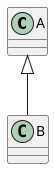

## V1 — fence sans accolades



## V2 — classe .plantuml sur fence accolade-free

```{.plantuml}
@startuml
C <|-- D
@enduml
```

## V3 — attribut raw

```{=html}
<!-- témoin négatif: ne doit rien produire d'inattendu -->
```
